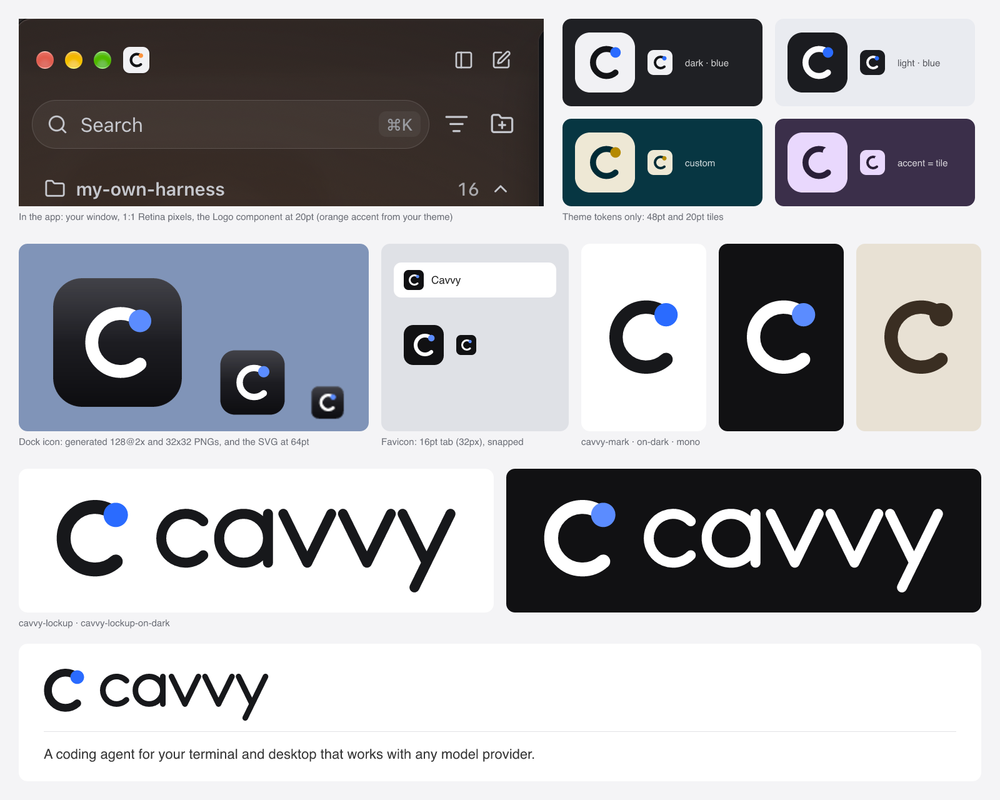

# Cavvy logo



A *cavvy* (or remuda) is the string of saddle horses on a cattle drive: riders
switch to a fresh horse through the day without stopping the drive. Cavvy does
that with models, API providers and Claude or ChatGPT subscriptions alike.

The mark is a lowercase c with a dot on its top end, the same "shape + accent
dot" the old H had. The wordmark is a monoline lowercase drawn from the same
strokes: round caps, round joins.

## Colour comes from the theme

In the app the mark has roles, not colours (the `Logo` component in
`gui/src/components/ui/bits.tsx`):

| Part | Token |
| --- | --- |
| Tile | `--rail-fg` (in the rail), `--fg` elsewhere |
| The c | `--sheet` |
| Dot | `--accent` |

So it follows every theme, custom ones included. The shape has to work without
the dot: when a theme's accent matches the tile, it's still a clean c.

Places that can't read the app's tokens (the dock, Finder, installers, the
README, the web) use the default dark theme: dark tile, white c, blue dot.

## Sharp at small sizes

The c is snapped to the pixel grid where it's smallest:

- **Rail tile (20pt on a 2x screen, 1.6 units a pixel):** 4px stroke, and the
  outer left, top and bottom edges and the inner left edge on pixel lines
  (centre 33.6, 32; radius 14.4).
- **Favicon (16pt, 2 units a pixel):** its own snap (centre 34, 32; radius 15;
  stroke 6).

If you change the geometry, keep it on these grids and change `build.ts` and
the `Logo` component together.

## Files

| File | Use |
| --- | --- |
| `cavvy-icon.svg` | App icon, 1024 grid. Copied to `desktop/icon.svg`, the source for the Tauri icon set. |
| `favicon.svg` | Browser tab. Copied to `gui/public/favicon.svg`. |
| `cavvy-mark.svg`, `cavvy-mark-on-dark.svg` | The bare mark on light and dark backgrounds. |
| `cavvy-mark-mono.svg` | One colour (`currentColor`): tray and menu-bar template images. |
| `cavvy-wordmark.svg` | The wordmark alone (`currentColor`). |
| `cavvy-lockup.svg`, `cavvy-lockup-on-dark.svg` | Mark and wordmark, for the README and site headers. |

Write the name in lowercase in the logo and as *Cavvy* in running text.

## Changing it

The files are generated: edit `build.ts`, then run

```bash
bun design/logo/build.ts
cd desktop && bunx tauri icon icon.svg -o "$(mktemp -d)"   # then copy the files that src-tauri/icons already has
```

`tauri icon` also writes `android/` and `ios/` folders; the app doesn't ship
them.
